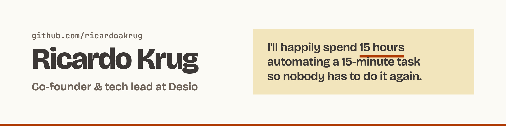

<picture>
  <source media="(max-width: 600px) and (prefers-color-scheme: dark)" srcset="assets/header-mobile-dark.png">
  <source media="(max-width: 600px)" srcset="assets/header-mobile-light.png">
  <source media="(prefers-color-scheme: dark)" srcset="assets/header-dark.png">
  
</picture>

# Hi, I'm Ricardo!

I'm co-founder and technical lead at [Desio](https://desio.app). We are building tools for hospitality businesses to manage their online presence, operations, and customer relationships.

What draws me to technology is how it expands what people can do. It can put something previously out of reach within someone's grasp, help them make sense of a problem, or free their attention for work and people that matter to them. That's what I want the things I build to make possible.

I'm also the kind of lazy person who will happily spend 15 hours automating a recurring 15-minute task so I never have to do it again (possibly a side effect of ADHD). I like putting the effort in once to remove work that would otherwise keep demanding someone's time. For me, that's a very practical expression of **technology as a human enabler**.

## Currently

- 🏗️ Building [Desio](https://desio.app), tools for hospitality businesses
- ✍️ Writing at [ricardokrug.com.br](https://ricardokrug.com.br)
- 🤖 Automating my own development workflow with AI agents

## Latest writing

<!-- BLOG-POSTS:START -->
- [Make your business report to you](https://ricardokrug.com.br/en/blog/one-morning-message) · Oct 20, 2026
- [90 Minutes and a Lunch: How AI Is Really Regulated](https://ricardokrug.com.br/en/blog/rule-versus-discretion) · Oct 16, 2026
- [How I Use AI on This Blog](https://ricardokrug.com.br/en/blog/welcome-world) · Oct 12, 2026
<!-- BLOG-POSTS:END -->

## How I got here

Although I've always been a technologist at heart, my background is in research and teaching. I earned my master's at the Universidade de São Paulo, where I focused on philosophy of science, particularly questions of method: how we come to know something, how we investigate it, and where the limits of that knowledge are.

That still shapes how I build things. I like **diagnosing a problem before deciding what to do about it**, questioning my assumptions, and checking whether the result actually supports the idea I started with.

Teaching also made me care about something that's easy to overlook in software: **the person on the other side**. A system's usefulness depends on what people can actually do with it, not just what we say it does. The user is part of how the system works, rather than someone who arrives after the real work is finished.

## What I want to build

Building toward that means being deliberate about the tradeoffs. Every tool enables some things and constrains others. Making a task automatic might save effort while taking away flexibility or making it harder to understand what's happening. I find those compromises interesting: **useful for whom, for what, and at what cost?**

That's why I care about both user and developer experience. Whether I'm working on a restaurant's daily operations or automating parts of my own development workflow, I want the system to make sense to the person using it and fit the task they actually need to do.

If any of that resonates, I'd enjoy comparing notes.

[ricardokrug.com.br](https://ricardokrug.com.br) · [ricardo@desio.app](mailto:ricardo@desio.app)
